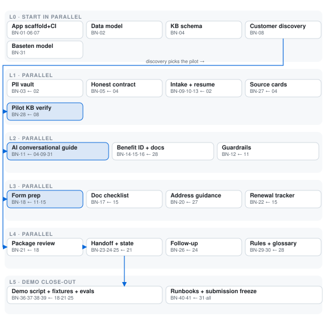

# Benefits Navigator — feature map (draft v0.2)

**Status:** Draft for team review — documentation only; authorizes no build work.
**As of:** 2026-10-28 (day 2 of 8; submission Wed Nov 4, 9:00 PM ET; internal target 6:00 PM ET)
**Concept source:** team meeting doc — AI navigator for government benefits for people experiencing homelessness
**Scope rule:** one benefit, one location, one end-to-end journey; verify one real workflow before expanding.

**Decisions applied (Oct 27–28):** BlueBricks withdrawn; current direction is the benefits navigator (direction chosen, key choices still open below) · piggyback gates adopted: no repo under 500 stars, nothing unpushed for over a month, highest stars win · **docassemble (994 stars, MIT, pushed Oct 27) is the only qualifying repo — COPY-SEMANTICS, do not run it** · Meta open-weight model served on Baseten (pass/fail gate + open-weight track) · synthetic/rights-cleared demo data only.

## Strategic notes

- **Disqualification trap:** the event anti-project list bans "basic RAG apps." Lead with the guided workflow agent (intake, checklist, prep, handoff, tracking) — never "AI answers benefits questions."
- **Gate and bonus align:** serving a Meta open-weight model on Baseten satisfies the pass/fail gate and the $10K open-weight track. Model ID must be `meta-models/muse-spark-open-1026`; the docs' default ID is a known trap.
- **The moat is content:** no open-source project has current, source-linked benefit rules for any single US state. The verified pilot knowledge base (BN-28) is the core deliverable.

## M0 — Foundations and guardrails

| ID | Feature |
|---|---|
| BN-01 | App scaffold: TS-strict web app, ESLint, test runner, CI wiring (AGENTS.md gate applies to first app PR) |
| BN-02 | Data model v1 + migrations: person/session, caseworker-assisted session, progress records |
| BN-03 | **Secure data layer:** PII vault structurally separated from the prompt pipeline — identity details/documents never enter model context; allowlisted fields only, enforced at the boundary |
| BN-04 | Verified knowledge-base schema: versioned, source-linked program entries (rules, required documents, official links, deadlines, retrieval dates) |
| BN-05 | Honest-answers contract: banned-claims enforcement (no eligibility/approval promises), tri-state unknowns, `prepared ≠ submitted` states |
| BN-06 | Telemetry/log hygiene: zero PII in prompts, logs, or traces; request IDs; error taxonomy |
| BN-07 | Accessibility baseline: semantic headings, labels, keyboard operability, visible focus, announced status changes — for this user population it is a feature, not a nicety |
| BN-08 | **Customer-discovery sprint (timeboxed):** talk to shelter/caseworker contacts; pick pilot benefit + location from evidence; log consented findings — this decides BN-28 and the demo |

## M1 — Conversational intake

| ID | Feature |
|---|---|
| BN-09 | Plain-language intake: a small set of situation + location questions (web first; SMS/voice gated) |
| BN-10 | Caseworker-assisted mode: same session operable by a helper ("I'm helping someone else"), with an audit note |
| BN-11 | AI conversational guide: asks the next relevant question, explains unfamiliar terms from the glossary, grounded on KB entries (Meta open-weight model via Baseten) |
| BN-12 | Grounding + injection guardrails: answers only from KB entries; explicit "I don't have verified info on that" when coverage is missing; user free text treated as data, never instructions |
| BN-13 | Save/resume: progress persists across sittings — no requirement to finish in one session |

## M2 — Benefit identification

| ID | Feature |
|---|---|
| BN-14 | Program presentation for the pilot: "this may be worth pursuing" + reasons + what's needed — no eligibility determination (a labeled screener only if the legal review permits it; gated) |
| BN-15 | Requirements extraction: required documents, steps, deadlines, renewal dates as a checklist, each item source-linked |
| BN-16 | Unknown surfacing: missing facts (ID? address? income proof?) shown as explicit to-resolve items, never inferred |

## M3 — Application preparation

| ID | Feature |
|---|---|
| BN-17 | Document checklist in plain language: what each document is, how to replace it, official links |
| BN-18 | Conversational form prep: one question at a time; answers organized into a prepared application package |
| BN-19 | Document handling (scope decision): P0 default is checklist-only; uploads only if the secure-data decision allows (then bounded, encrypted, outside the prompt pipeline) |
| BN-20 | Mailing-address guidance: sourced steps for getting mail without a fixed address (shelter address with consent, general delivery, PO box) — the concept's named barrier, as guidance links, not promises |
| BN-21 | Prepared-package review: person/caseworker reviews everything before handoff; provenance labels (user-supplied vs AI-drafted) |
| BN-22 | Renewal/deadline tracker: KB dates + user-reported events clearly labeled; in-app reminders (SMS if the channel decision allows) |

## M4 — Handoff and tracking

| ID | Feature |
|---|---|
| BN-23 | Handoff view: what can be done in-product vs what happens on the official site or with a caseworker — one clear next action |
| BN-24 | Official-portal companion: deep links + ordered step-by-step for the official application; **no auto-submission in P0** |
| BN-25 | `prepared ≠ submitted` state machine: draft → prepared → handed off → *user-reported* submitted → *user-reported* decided; external statuses require user report + evidence note |
| BN-26 | Follow-up explainer: what mail/notices to expect, what they might mean — sourced from official guidance |

## M5 — Knowledge base

| ID | Feature |
|---|---|
| BN-27 | Source cards: every requirement/document/deadline shows official source + retrieval date + version |
| BN-28 | **Pilot KB verification:** trace the actual chosen program's application path end-to-end with real sources — the "one real workflow" proof (depends on BN-08) |
| BN-29 | Rules-change handling: versioned entries; stale/withdrawn states; the assistant never cites stale rules silently |
| BN-30 | Plain-language glossary: benefits terms explained from official sources, used by the assistant |

## M6 — Meta AI integration (the pass/fail gate)

| ID | Feature |
|---|---|
| BN-31 | **Baseten serving of a Meta open-weight model** (`meta-models/muse-spark-open-1026`): deploy, smoke test, latency check; qualifies the build for the open-weight track |
| BN-32 | Structured-output adapter: strict schema for next-question / term-explanation / requirement-explanation outputs; app validates; failures become visible errors, never silent scope edits |
| BN-33 | Prompt/data boundary: minimized context (allowlisted non-identifying fields only), provenance recorded per response, one visible retry per action |
| BN-34 | Fine-tune gate: default OFF; only a timeboxed experiment if testing shows the base model can't do the job |
| BN-35 | Cost discipline: small-context prompts, caching where appropriate, spend caps on both Baseten and Meta credits |

## M7 — Demo and proof

| ID | Feature |
|---|---|
| BN-36 | One-journey demo script: plain-language story → program + documents → short intake → clear handoff → next step; 3 minutes |
| BN-37 | Synthetic/rights-cleared persona fixtures (zero real resident data), labeled as such |
| BN-38 | Evaluation record: what the assistant got right / wrong / refused on the pilot journey; denominator + negative cases kept |
| BN-39 | Customer-discovery evidence in the demo: consented quotes from a shelter/caseworker/user showing the workflow hits a real obstacle |
| BN-40 | Failure runbooks: model unavailable (fall back to the static guided checklist — the demo survives), source down, wrong-answer handling |
| BN-41 | Submission freeze: repo public, video link, credits claimed, contributors listed, originality check |

## Decision-gated (default out)

| Item | Default |
|---|---|
| BN-42 SMS/voice channel | Web only in P0 |
| BN-43 Auto-submission of the application | Never in P0 — legal/reliability boundary |
| BN-44 Multi-program/multi-county expansion | One benefit, one location |
| BN-45 Fine-tuning on Baseten | Off unless BN-34's gate trips |
| BN-46 Uploads of identity documents | Checklist-only unless the secure-data decision allows |

## Dependency layers

Everything inside a layer runs in parallel with its layer-mates; an item cannot start until every blocker in its tag is done.

| Layer | Parallel work | Blocked by |
|---|---|---|
| L0 — day 1 | App scaffold+CI+a11y (BN-01/06/07) · Data model (BN-02) · KB schema (BN-04) · Customer discovery (BN-08) · Baseten model (BN-31) | nothing |
| L1 | PII vault (BN-03) · Honest contract (BN-05) · Intake+resume (BN-09/10/13) · Source cards (BN-27) · **Pilot KB verify (BN-28)** | L0 |
| L2 | AI guide (BN-11) · Benefit ID+docs (BN-14/15/16) · Guardrails (BN-12) | L1 |
| L3 | Form prep (BN-18) · Doc checklist (BN-17) · Address guidance (BN-20) · Renewal tracker (BN-22) | L2 |
| L4 | Package review (BN-21) · Handoff+state machine (BN-23/24/25) · Follow-up (BN-26) · Rules+glossary (BN-29/30) | L3 |
| L5 — close-out | Demo script+fixtures+evals (BN-36–39) · Runbooks+freeze (BN-40/41) | L4 |

**Critical path:** BN-08 discovery → BN-28 pilot KB verify → BN-14/15/16 benefit ID → BN-18 form prep → BN-21 review → BN-23/24/25 handoff → BN-36 demo. BN-31 (Baseten) is a parallel rail that meets the spine at BN-11. If discovery slips past Oct 30, freeze the pilot choice with best-available evidence rather than slipping everything downstream.

## Piggyback scan summary (Oct 28)

Gates: minimum 500 stars; updated within the last month; highest stars win. Verified via the GitHub API.

| Repo | Stars | Last push | Verdict |
|---|---|---|---|
| jhpyle/docassemble | 994 | Oct 27 | **PASSES — the only one** |
| openfisca/openfisca-core | 249 | Oct 23 | Fails stars (also AGPL-3.0) |
| PolicyEngine/policyengine-us | 170 | Oct 28 | Fails stars (license mid-transition) |
| openreferral/specification | 131 | Oct 28 | Fails stars |
| SuffolkLITLab/docassemble-AssemblyLine | 70 | Oct 28 | Fails stars |
| hackforla/expunge-assist | 43 | Jan 2026 | Fails both |
| ShelterTechSF/askdarcel-web | 29 | Oct 26 | Fails stars (GPL-3.0) |
| navapbc/labs-assistive-chatbot | 5 | Oct 19 | Fails stars badly |
| NYCOpportunity/benefits-screening-rules | 0 | Oct 5 | Fails (also no license file) |
| codeforamerica/getcalfresh | — | — | Repo deleted (404); service wound down Aug 2026 |

Only docassemble passes. Everything else is a pattern reference — we take ideas, not code.

## Piggyback plan — docassemble

[docassemble](https://docassemble.org/) is the leading open-source guided-interview and document-assembly platform (MIT, jhpyle/docassemble): YAML-defined interviews that ask one question per screen, store answers server-side as an encrypted per-session dictionary, and end in assembled documents. Its interview semantics — one-question-per-screen flow, review screens, per-question plain-language help, save/resume by session URL, and a strict "assemble, never submit" endpoint — map almost one-to-one onto our benefits-navigator feature set. We copy those semantics into our Next.js app rather than operating docassemble itself.

| Our feature | docassemble pattern | Mode |
|---|---|---|
| Intake flow (BN-09) | One `question`/`fields` block per screen with skip logic | COPY-SEMANTICS |
| Caseworker mode (BN-10) | Session API access for a second party (docs/api.html) | COPY-SEMANTICS |
| Save/resume (BN-13) | Server-side session dict resumable via session ID/URL | COPY-SEMANTICS |
| Document checklist (BN-17) | Upload fields surfaced in editable review tables | COPY-SEMANTICS |
| Conversational form prep (BN-18) | "Questionless interview": set variables via `/api/session`, engine returns next needed field | COPY-SEMANTICS |
| Plain-language glossary (BN-30) | `terms` blocks + per-question `help` text | COPY-SEMANTICS |
| Package review screen (BN-21) | `review` blocks: answered vs still-needed list | COPY-SEMANTICS |
| Prepared≠submitted state (BN-25) | Engine ends at assembled documents; no submission step exists | COPY-SEMANTICS |
| Pilot KB verification aid (BN-28) | No equivalent | N-A |
| PII boundary (BN-03) | PII stays server-side in encrypted sessions, outside LLM prompts | COPY-SEMANTICS |

**Chosen option: COPY-SEMANTICS into our Next.js app** (not running docassemble). Integration outline:

1. Model the benefits application journey as a question spec (id, prompt, field type, `help`, `terms`, skip conditions) — the YAML interview, as JSON.
2. Back each user session with a server-side `answers` JSONB + status flags (`in_progress`, `prepared`, `submitted: never`), resumable by session ID.
3. Build the one-question-per-screen flow driven by the spec; the Baseten LLM chooses phrasing/next-step framing but the state machine stays deterministic.
4. Add a review screen listing completed vs still-needed items and required documents, modeled on docassemble `review` tables.
5. Keep all PII in our server-side answers store; prompts to Baseten contain only non-PII context.
6. If demoing output, generate a filled application PDF with `pdf-lib` against a fillable source PDF.

Risks: we re-implement edge cases docassemble already solved (back/branching/review editing); learning-curve savings now become engineering debt later if we outgrow the spec; no LIFT-CODE from docassemble (Python/Flask, incompatible with our Next.js stack). Verified separately: docassemble's native `multi_user` mode disables session encryption, so caseworker-assisted access should go through our own backend instead. Baseten's OpenAI-compatible endpoint status and the pilot state's PDF fillability are unverified — check before promising PDF output in the demo.

## Open decisions

1. First benefit and location — BN-08 customer discovery decides (the pilot program discussed, unverified)
2. Web vs SMS/voice — BN-42 (web default)
3. How much of an application can legally and reliably be automated — BN-43 (no auto-submission in P0)
4. Primary user: applicant, caseworker, or both — BN-10
5. Demo output: filled PDF only if the state's application PDF has fillable fields (unverified — check before promising it)
